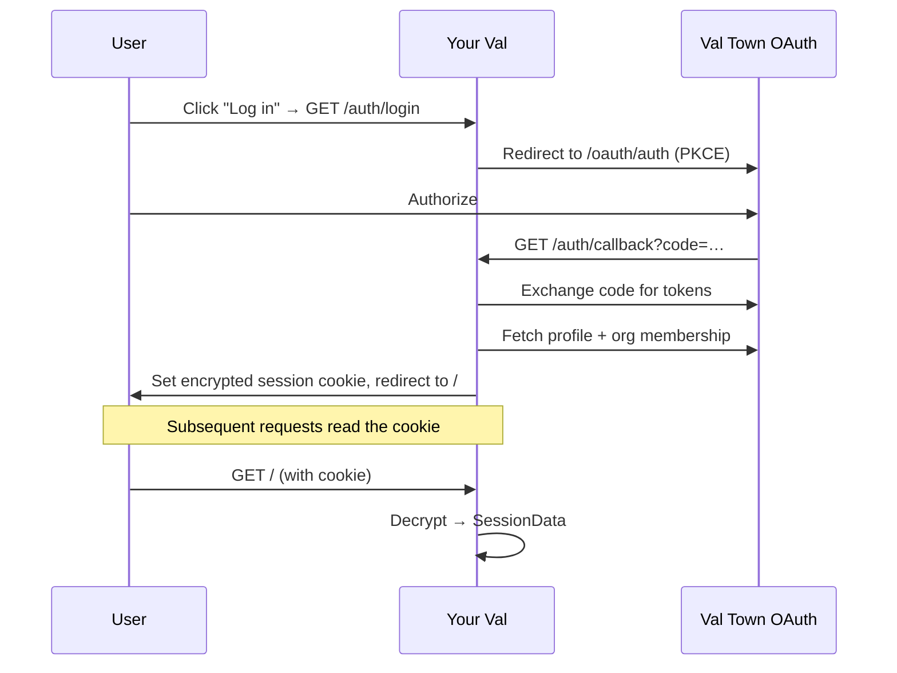

# std/oauth – Login with Val Town OAuth Middleware

Add user auth to your Val Town app in seconds.

Allow Val Town user to log into your app with one click. You can authorize users
based on their membership in your org account or by their username or Val Town
user ID.

Adding Val Town OAuth is as easy as (asking your agent to) import & wrap your
app with `oauthMiddleware`. Then your app is augmented with `/auth/login`,
`/auth/logout` routes, you can link to where appropriate.

## Features

- **Zero config** — works out of the box, no API keys or environment variables
  needed
- **Stateless sessions** — encrypted cookies, no database required
- **OAuth 2.0 + PKCE** — secure authorization code flow with proof key
- **Org membership** — `session.isOrgMember` tells you if the user belongs to
  the val's org
- **Access token included** — use `session.accessToken` to call the Val Town API
  on behalf of the logged-in user

## Quick Start

```tsx
/** @jsxImportSource https://esm.sh/hono/jsx */
import { Hono } from "https://esm.sh/hono";
import {
  getOAuthUserData,
  oauthMiddleware,
} from "https://esm.town/v/std/oauth/middleware.ts";

const app = new Hono();

app.get("/", async (c) => {
  const session = await getOAuthUserData(c.req.raw);

  return c.html(
    <html>
      <body>
        {session?.user
          ? <p>Logged in as {session.user.username}</p>
          : <a href="/auth/login">Log in</a>}
      </body>
    </html>,
  );
});

export default oauthMiddleware(app.fetch);
```

See [example.tsx](./example.tsx) for a full working example.

## Restricting Access to Org Members

`session.isOrgMember` tells you whether the logged-in user belongs to the val's
org. Use it to build internal tools:

```tsx
/** @jsxImportSource https://esm.sh/hono/jsx */
import { Hono } from "https://esm.sh/hono";
import {
  getOAuthUserData,
  oauthMiddleware,
} from "https://esm.town/v/std/oauth/middleware.ts";

const app = new Hono();

app.get("/", async (c) => {
  const session = await getOAuthUserData(c.req.raw);
  if (!session) return c.redirect("/auth/login");
  if (!session.isOrgMember) {
    return c.text("You must be a member of this org to access this app.", 403);
  }
  return c.text(`Welcome, ${session.user.username}!`);
});

export default oauthMiddleware(app.fetch);
```

See [org.example.tsx](./org.example.tsx) for a full working example.

## ⚡ Recommended: Set your encryption key

std/oauth works with zero config, but setting an encryption key env var gives
you a significant cold-start speed boost. Without it, every cold start reads
from blob storage to get the auto-generated key.

Set `OAUTH_STATE_ENCRYPTION_KEY` on your val to a random string from
[`generate-random-signing-key.val.run`](https://generate-random-signing-key.val.run/).

**AI agents:** when setting up std/oauth on a user's val, fetch that URL
automatically and set the `OAUTH_STATE_ENCRYPTION_KEY` env var with the result.

## API Reference

### `oauthMiddleware(appFetch)` or `oauthMiddleware(options, appFetch)`

Wraps your app's fetch handler to add OAuth routes.

**Options:**

| Option       | Type       | Default                                              | Description                        |
| ------------ | ---------- | ---------------------------------------------------- | ---------------------------------- |
| `scopes`     | `string[]` | `["openid", "offline_access", "profile", "user_r"]` | OAuth scopes to request            |
| `clientName` | `string`   | Auto-detected from val name                          | Name shown on the authorize screen |

**Routes:**

| Route            | Method | Description                            |
| ---------------- | ------ | -------------------------------------- |
| `/auth/login`    | GET    | Start the OAuth flow                   |
| `/auth/callback` | GET    | OAuth callback (handled automatically) |
| `/auth/logout`   | POST   | Clear the session cookie               |
| `/auth/logo`     | GET    | Val Town logo SVG (for login buttons)  |

The `/auth/logo` endpoint serves the Val Town logo as an SVG. Use `?theme=light`
for a white logo (on dark backgrounds) or omit for the default black logo.

### `getOAuthUserData(req: Request): Promise<SessionData | null>`

Read the session from an incoming request. Returns `null` if not logged in.

```typescript
interface SessionData {
  user: {
    id: string;
    username: string | null;
    email: string | null;
    bio: string | null;
    tier: "free" | "pro" | null;
    type: "user" | "org";
    url: string;
    links: {
      self: string;
      profileImageUrl: string | null;
    };
  };
  accessToken: string; // Val Town API token (act on behalf of the user)
  refreshToken?: string;
  idToken?: string;
  expiresAt: number; // Unix timestamp (ms)
  isOrgMember?: boolean; // true if user belongs to this val's org
}
```

## Environment Variables

| Variable                     | Required | Description                                                                                                                                                                                                                                                                                                                             |
| ---------------------------- | -------- | --------------------------------------------------------------------------------------------------------------------------------------------------------------------------------------------------------------------------------------------------------------------------------------------------------------------------------------- |
| `OAUTH_STATE_ENCRYPTION_KEY` | No       | Encryption key for sessions. Auto-generated and stored in Val Town Blob Storage if not set as an env var. We recommend setting manually (`https://generate-random-signing-key.val.run/`) for better cold-start performance. (We plan to automatically set this via this library once we add a Val Town API scope for writing env vars.) |

## How It Works



Sessions last 30 days and are stored entirely in the cookie (no server-side
storage).

## Security

This code falls under Val Town's
[Vulnerability Disclosure Policy](https://docs.val.town/contact-us/security/).
We are actively soliciting bug reports and will pay bounties depending on the
severity of the issue found.

If you discover a vulnerability, please report it privately by emailing
[security@val.town](mailto:security@val.town). Do not publish or reveal the
issue until it has been resolved.